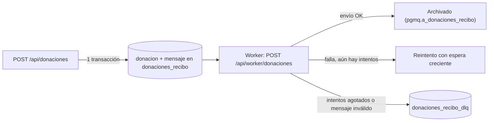
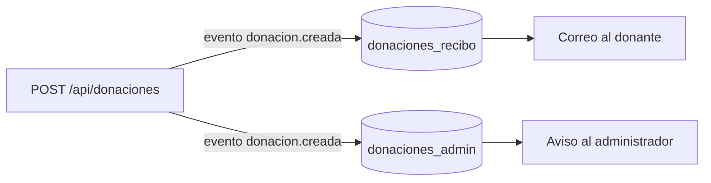

# Plataforma web de Donaton para curso Desarrollo Cloud Native 01.

Repositorio de la plataforma web de Donaton usado para el curso Desarrollo Cloud Native 01.

Integrantes del proyecto:

- Benjamin Llanquiman ([@BenjaminLlanquiman](https://github.com/BenjaminLlanquiman)).

- Remi García ([@rem-garcia](https://github.com/rem-garcia)).

- Ricardo Díaz ([@ric-diazs](https://github.com/ric-diazs)).

---

## Tecnologías principales.

Las principales tecnologías usadas hasta ahora en este proyecto, son las siguientes:

- Backend: Next JS (App Router, v16), Prisma (v7), TypeScript (v5) y Supabase (PostgreSQL y servicio Auth).

- Frontend: React JS (v19), TypeScript (v6), TailwindCSS (v4) y Vite (v8).

---

## Ejecución de la plataforma.

La plataforma de Donaton está actualmente en etapa de desarrollo. Para interactuar con ella, se requiere tener las siguientes herramientas instaladas:

- Node.js (v24 o superior).

- NPM (v11 o superior).

- Git (v2.55 o superior).

- Navegador web de preferencia (por ejemplo, Google Chrome, Mozilla Firefox, Brave, Microsoft Edge, etc).

Para el uso funcional de la plataforma (es decir, para poder utilizar los formularios de registro), también se requiere el uso de variables de entorno para el backend. Para ello, crea un archivo `.env` con la siguiente estructura:

```dotenv
# Connect to Postgres via the shared transaction-mode pooler (IPv4-only)
DATABASE_URL="postgresql://[USUARIO]:[PASSWORD]@[HOSTNAME]:[PUERTO]/[DATABASE]?pgbouncer=true"

# Connect to Postgres via the shared session-mode pooler (used for migrations)
DIRECT_URL="postgresql://[USUARIO]:[PASSWORD]@[HOSTNAME]:[PUERTO]/[DATABASE]"

# Variables de entorno de NextJS usadas en Supabase
NEXT_PUBLIC_SUPABASE_URL="https://[SUPABASE_URL]"

NEXT_PUBLIC_SUPABASE_PUBLISHABLE_KEY="[SUPABASE_PUBLISHABLE_KEY]"

SUPABASE_SECRET_KEY="[SUPABASE_SECRET]"

# JWT
JWT_SECRET=[JWT_SECRET_KEY]

# Cola de recibos (pgmq)
# Secreto con el que pg_cron/pg_net autentica la llamada al worker (POST /api/worker/donaciones)
WORKER_SECRET=[WORKER_SECRET]
# Envio de correos con Resend (si faltan, en desarrollo el correo solo se imprime en consola)
RESEND_API_KEY=[RESEND_API_KEY]
MAIL_FROM="Donaton <no-reply@[DOMINIO]>"
# Opcional: intentos antes de enviar un mensaje a la dead letter queue (por defecto 3)
QUEUE_MAX_RETRIES=3
# Opcional: correo del administrador que recibe el aviso de cada donacion (sin el, solo se registra en el log)
ADMIN_EMAIL=[ADMIN_EMAIL]
```
La información secreta del archivo de variables de entorno es manejado solo por los miembros del equipo de este proyecto y no es compartida públicamente en este repositorio por temas de seguridad. De necesitarlas, contáctese con el equipo en cuestión.

Al asegurar que las herramientas mencionadas arriba están instaladas, ingresa a una terminal en una carpeta de tu interés y clona el repositorio:

```bash
git clone https://github.com/ric-diazs/donaton-cloud-native-01.git
```

Luego, ingresa a la carpeta `donaton-cloud-native-01`:

```bash
cd donaton-cloud-native-01
```

Posteriormente, ingresa a la carpeta del backend e instala las dependencias de dicho proyecto:

```bash
cd backend

npm install
```

Cuando se hayan instalado las dependencias del backend, primero ejecuta el siguiente comando si es que estás corriendo por primera vez el backend:

```bash
npx prisma generate
```

De este modo, se genera el modelo de datos del backend con la ayuda del ORM Prisma.

Si el comando anterior se corrió exitosamente, ejecuta el backend en modo dev con el siguiente comando:

```bash
npm run dev
```

El backend generará una URL a nivel local (`localhost` o en la dirección de IP `127.0.0.1`) con destino al puerto `3000` (es decir, `http://localhost:3000`).

Luego de haber ejecutado exitosamente al backend, regresa a la carpeta raíz del repositorio e ingresa a directorio `frontend`.

```bash
cd ../

cd frontend
```

En la carpeta del frontend, instala sus dependencias:

```bash
npm install
```

Si las dependencias se instalaron sin problemas, corre el frontend en modo dev usando el siguiente comando:

```bash
npm run dev
```

El comando de arriba ejecutará el frontend con la ayuda de Vite, el cual generará una URL para acceder a su servidor web a nivel local (`localhost` o en la dirección de IP `127.0.0.1`) con destino al número de puerto `5173` (es decir, `http://localhost:5173`). Para ver el frontend, ingresa a dicha URL desde tu navegador web de preferencia.

---

## Explicación del caso.

El desarrollo de este proyecto está basado en un caso ficticio de una fundación llamada Donaton, cuya labor consiste en facilitar el proceso logístico de entrega de donaciones en contextos de catástrofe o emergencias.

En la actualidad, Donaton enfrenta problemas de coordinación entre los colaboradores y de manejo de información con los donantes, lo que ha llevado a que 65% de las donaciones recibidas durante emergencias y catástrofes no correspondan a necesidades prioritarias, el 50% de los centros de acopio reporta problemas de saturación durante catástrofes y 70% de los donantes afirma no tener claridad sobre qué productos son realmente necesarios. Ante estas dificultades, la fundación a considerado que una forma de hacerles frente es mediante un producto de software.

---

## Modulos principales.

Actualmente el sistema cuenta con tres módulos, los cuales son accesibles según el rol asignado:


| Módulo |Descripción| Rol |
|--------|-----------|-----|
|Gestión de usuarios|Registro y vista de usuarios del sistema|Admin|
|Gestión de donaciones|Registro de donaciones realizadas en centros de acopio|Voluntario|
|Gestión de necesidades|Registro de las necesidades de la población afectada en tiempo real|Colaborador|

La implementación del acceso basado en roles (*Role Based Access Control* o RBAC) se realiza con el uso de JSON Web Tokens para la autenticación de los usuarios, el cual es generado desde el backend de la plataforma y consumido en su frontend.

Por otra parte, la gestión de las APIs de la plataforma son gestionadas desde la misma página web de Github.

---

## Cola de recibos de donación (pgmq).

Al registrar una donación, el backend guarda la donación y encola el envío de un recibo al correo del donante. El correo no se envía en la misma petición: lo procesa un *worker* que lee la cola. Si el envío falla, se reintenta y, al agotar los intentos, el mensaje se guarda en una *dead letter queue* (DLQ) para revisarlo después.

La cola usa la extensión [pgmq](https://supabase.com/docs/guides/queues/pgmq) de Supabase (Postgres), por lo que no requiere servicios adicionales.



### Colas.

| Cola | Descripción |
|------|-------------|
| `donaciones_recibo` | Un mensaje por donación creada, pendiente de enviar su recibo. |
| `donaciones_recibo_dlq` | Mensajes que agotaron sus reintentos o tenían un formato inválido. |
| `donaciones_admin` | Un mensaje por donación creada, pendiente de avisar al administrador. |
| `donaciones_admin_dlq` | Mensajes del suscriptor admin que agotaron sus reintentos o eran inválidos. |

### Configuración inicial.

Las colas se crean con la migración `prisma/migrations/*_agrega_colas_pgmq` (`npx prisma migrate deploy`) o, a mano, desde el SQL Editor de Supabase:

```sql
select pgmq.create('donaciones_recibo');
select pgmq.create('donaciones_recibo_dlq');
select pgmq.create('donaciones_admin');
select pgmq.create('donaciones_admin_dlq');
```

La extensión `pgmq` debe estar habilitada en el proyecto de Supabase (Integrations → Queues).

### Worker.

El endpoint `POST /api/worker/donaciones` procesa los mensajes pendientes. No usa la cookie de sesión: Procesa las colas de recibo y de admin, y responde un resumen: `{"leidos":1,"enviados":1,"reintentos":0,"enDlq":0,"admin":{"leidos":1,"procesados":1,"reintentos":0,"enDlq":0}}`

```bash
curl -X POST http://localhost:3000/api/worker/donaciones -H "Authorization: Bearer <WORKER_SECRET>"
```

Responde un resumen: `{"leidos":1,"enviados":1,"reintentos":0,"enDlq":0}`.

En un entorno desplegado, el worker se invoca cada minuto con `pg_cron` y `pg_net` desde Supabase. El script está en `prisma/sql/pg_cron_worker_donaciones.sql` y se ejecuta una sola vez a mano, reemplazando la URL pública del backend y el `WORKER_SECRET`. No puede apuntar a `localhost`.

### Reintentos y dead letter queue.

- Cada fallo reprograma el mensaje con espera creciente (30 s, 60 s, 120 s, etc.).
- Tras `QUEUE_MAX_RETRIES` intentos (3 por defecto), el mensaje se mueve a `donaciones_recibo_dlq` junto con el motivo del error.
- Un mensaje con formato inválido va directo a la DLQ, porque reintentarlo no lo arregla.

Para revisar el estado de las colas desde el SQL Editor de Supabase:

```sql
select * from pgmq.metrics_all();
select * from pgmq.q_donaciones_recibo_dlq;   -- mensajes en la DLQ (tabla interna de pgmq).
select * from pgmq.a_donaciones_recibo;       -- recibos ya procesados.
```
### Publish/Subscribe.

Al crear una donación se publica el evento `donacion.creada`. La función `publicarEvento` (`backend/src/lib/queue.ts`) copia el mensaje en la cola de cada suscriptor, dentro de la misma transacción que guarda la donación.



| Suscriptor | Cola | DLQ | Efecto |
|---|---|---|---|
| Recibo | `donaciones_recibo` | `donaciones_recibo_dlq` | Correo de agradecimiento al donante. |
| Admin | `donaciones_admin` | `donaciones_admin_dlq` | Aviso al administrador (`ADMIN_EMAIL`; sin ella solo se registra en el log). |

Cada suscriptor tiene su propio consumidor, sus propios reintentos y su propia DLQ, así que si uno falla no afecta al otro. Para agregar un suscriptor: crear su cola y su DLQ (migración), registrarla en `SUSCRIPCIONES` y escribir su consumidor.

### Correo.

Los correos se envían con [Resend](https://resend.com) usando las variables `RESEND_API_KEY` y `MAIL_FROM`. Si no están definidas y no se está en producción, el correo solo se imprime en la consola del backend.

El sistema entrega los mensajes *al menos una vez*: si el correo sale pero falla el archivado, el donante podría recibirlo dos veces.

### Politica de retencion

Un job de pg_cron (`retencion-colas-donaciones`) corre diariamente a las 03:00 UTC y borra:
- mensajes archivados (`pgmq.a_donaciones_recibo` y `pgmq.a_donaciones_admin`) con más de 7 días,
- mensajes de los DLQ (`donaciones_recibo_dlq` y `donaciones_admin_dlq`) con más de 30 días.

Es SQL puro y no depende del backend. Se programa una sola vez en el SQL Editor de Supabase
con el script `backend/prisma/sql/pg_cron_retencion_colas.sql`. Para detenerlo:
`select cron.unschedule('retencion-colas-donaciones');`